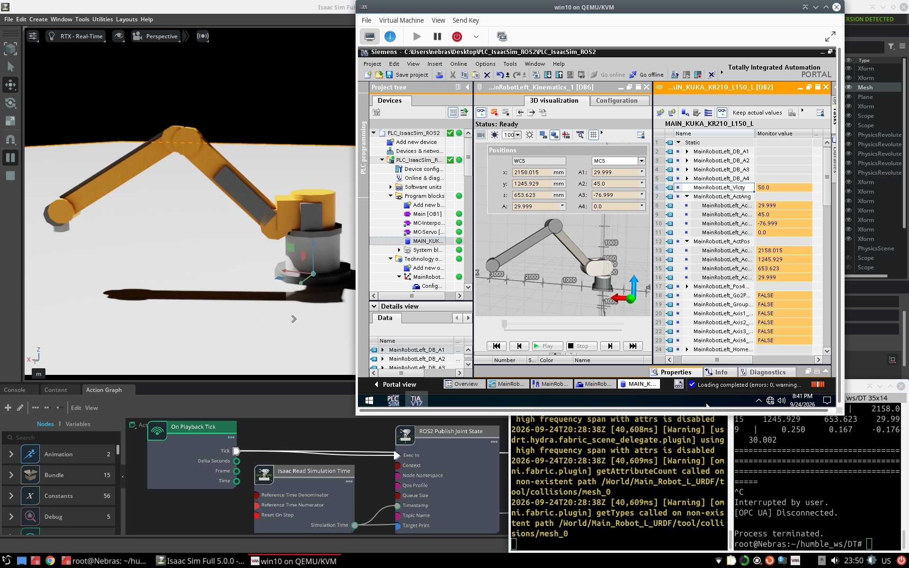
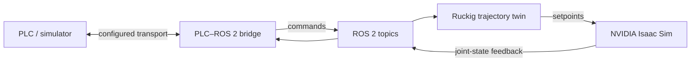

# Isaac Digital Twin — Multi-Vendor Robotics Simulation

[](LICENSE)
[](https://docs.ros.org/)
[](https://developer.nvidia.com/isaac/sim)

A configuration-driven digital-twin platform connecting PLC-controlled robot arms to **ROS 2** and **NVIDIA Isaac Sim**. It brings PLC communications, trajectory generation, robot configuration, and physics simulation into one documented project, with earlier KUKA and Yaskawa implementations retained for comparison.

> **In one sentence:** change robot and signal configuration in YAML, connect the PLC bridge to ROS 2, and run the robot twin in Isaac Sim.



## Why this project is interesting

- **Digital-twin integration:** PLC signals flow through a ROS 2 bridge to trajectory generation and a simulated robot, with feedback returned through the loop.
- **Configurable robot and signal mapping:** joint limits, signal names, and robot properties are described in YAML rather than embedded throughout the control code.
- **Motion generation:** online, jerk-limited trajectories use Ruckig.
- **Performance observability:** probe tags and analysis tools help measure latency across system stages.
- **Validation and testing:** configuration checks and tests cover type/range validation, trajectory behavior, probe handling, and selected failure cases.
- **Multi-generation engineering:** the repository preserves KUKA KR210 and Yaskawa GP110 reference implementations alongside the vendor-neutral platform.

## Architecture



The active vendor-neutral code is organized by responsibility:

| Area | Role |
| --- | --- |
| `vendor-neutral/ros2/` | PLC bridge, configuration schema, trajectory twin, and ROS 2 tests |
| `vendor-neutral/isaac/` | Isaac Sim physics twin and robot assets |
| `vendor-neutral/config/` | Robot and PLC signal configuration |
| `vendor-neutral/windows/` | Windows-side PLCSIM/TCP-JSON server |
| `vendor-neutral/docs/` | Setup, architecture, and performance documentation |
| `kuka/`, `yaskawa/` | Earlier robot-specific reference generations |

## Integration status

The checked-in bridge and configuration schema are the source of truth for which transports can be selected and run from this repository revision. The ADS guide and direct `pyads` connection tests demonstrate TwinCAT connectivity, but those checks alone do not establish that the full PLC → bridge → ROS 2 → Isaac Sim loop was verified with ADS. ADS latency is **not benchmarked** in the published measurements.

- **Measured legacy/reference result:** optimized TCP-JSON reported 5.2 ms mean and 16.3 ms maximum on the documented reference machine, for the version and test setup described in the performance notes. These figures are not a claim about every release, transport, or environment.
- **Measured simulation result:** KUKA tracking reported a maximum error of 0.0254° under the documented gravity-enabled test. The passive-joint value is not an independent tracking result.
- **Beckhoff/TwinCAT:** see the [ADS setup guide](vendor-neutral/docs/beckhoff_ads_setup.md) and its stated verification scope.

See the [vendor-neutral README](vendor-neutral/README.md) for detailed setup, test instructions, and historical measurements.

## Quick start

The platform requires ROS 2 and a compatible Isaac Sim installation. PLC-side prerequisites depend on the selected transport. See the [detailed setup guide](vendor-neutral/README.md#quick-start) before running against a PLC.

```bash
cd vendor-neutral

# Run the bridge using the checked-in configuration.
python3 ros2/plc_ros_bridge.py \
  --ros-args -p config:=config/plc_ros_bridge.yaml

# In a separate ROS 2 environment, run the trajectory twin.
python3 ros2/trajectory_twin.py \
  --ros-args -p robot:=config/robot.yaml
```

Run `vendor-neutral/isaac/physics_twin.py` from the Isaac Sim environment described in the setup guide. Start only the PLC server required by your selected transport.

## Tests

Core automated tests are under `vendor-neutral/ros2/`. Some ADS connection checks under `vendor-neutral/tests/` require a reachable, correctly configured TwinCAT system; they are not offline unit tests.

```bash
cd vendor-neutral/ros2
python3 -m pytest -q
```

For exact test scope, dependencies, and hardware requirements, see [Testing](vendor-neutral/README.md#testing).

## Safety

This is a **simulation and research project, not a certified safety system**. Its E-stop, heartbeat, and watchdog behavior is functional monitoring for the digital twin only. It is not designed or certified to protect people or physical machinery. Any physical installation needs an independent, appropriately certified safety system.

## Explore the repository

- [Vendor-neutral platform and detailed documentation](vendor-neutral/README.md)
- [TwinCAT 3 / ADS setup and verification scope](vendor-neutral/docs/beckhoff_ads_setup.md)
- [Latency comparison report](vendor-neutral/docs/latency_comparison.md)
- [KUKA KR210 reference generation](kuka/README.md)
- [Yaskawa GP110 reference generation](yaskawa/README.md)
- [Project changelog](CHANGELOG.md)

## About

Created by [Nebras Damsarkho](https://github.com/Nebras4u). The repository is licensed under Apache-2.0. For research citation information, see [`CITATION.cff`](CITATION.cff).
