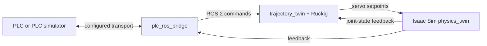

# Isaac Digital Twin — Vendor-Neutral Robotics Platform

A configuration-driven platform for connecting robot arms, PLC interfaces, ROS 2, and NVIDIA Isaac Sim. The vendor-neutral generation grew from the repository's [KUKA KR210](../kuka/README.md) and [Yaskawa GP110](../yaskawa/README.md) reference projects.

> **Project scope:** this is a simulation and research digital twin. Its monitoring and stop behavior are not certified safety functions and must not be used to protect people or physical equipment.


## At a glance

- **PLC integration:** a ROS 2 bridge, configurable signal mapping, and transport-specific drivers.
- **Robot integration:** YAML-based joint names, limits, and Isaac Sim articulation configuration.
- **Motion:** jerk-limited online trajectory generation with Ruckig.
- **Observability:** latency-probe tags, diagnostic counters, and offline CSV analysis.
- **Validation:** schema checks, type/range validation, finite-number guards, and automated tests.

## Architecture



### Repository layout

| Path | Contents |
| --- | --- |
| `ros2/` | `plc_ros_bridge.py`, `bridge_config.py`, `trajectory_twin.py`, probe tools, and core tests |
| `isaac/` | Isaac Sim physics twin and robot assets |
| `config/` | `plc_ros_bridge.yaml` and `robot.yaml` |
| `windows/` | Windows PLCSIM Advanced TCP/JSON server |
| `plc/` | PLC SCL source and data-block references |
| `docs/` | Architecture, ADS setup, and performance reports |
| `tests/` | ADS connection tests that require a reachable TwinCAT target |

## Transport and verification status

Use the driver registry and configuration schema in `ros2/plc_ros_bridge.py` and `ros2/bridge_config.py` as the definitive list of transports available in a particular checkout. The repository includes a Beckhoff TwinCAT 3 ADS setup guide and direct `pyads` connection tests. Those tests cover ADS connectivity and read/write against a PLC; they do **not** by themselves verify the complete ADS-to-ROS-to-Isaac control loop. ADS latency remains unmeasured.

The repository also contains historical measurements for other transports and versions. Do not interpret them as current ADS results or guaranteed performance on different hardware.

## Quick start

### Prerequisites

- Ubuntu 22.04/24.04 with ROS 2 Humble or Jazzy for the bridge and trajectory node.
- A compatible NVIDIA Isaac Sim installation with its ROS 2 bridge enabled for the physics twin.
- PLC-specific software, network, and routing configuration for the selected transport.

Use a virtual environment for Python packages where appropriate, and follow the Isaac Sim-specific Python/ROS environment instructions in the [setup notes](docs/beckhoff_ads_setup.md) and project documentation.

### Run the ROS 2 processes

From `vendor-neutral/`, with ROS 2 sourced in the bridge environment:

```bash
python3 ros2/plc_ros_bridge.py \
  --ros-args -p config:=config/plc_ros_bridge.yaml
```

In a second terminal:

```bash
python3 ros2/trajectory_twin.py \
  --ros-args -p robot:=config/robot.yaml
```

Run `isaac/physics_twin.py` inside the Isaac Sim Script Editor/environment, following the documented startup sequence. Start the Windows TCP/JSON server only when the selected PLC configuration requires it.

### Run the core tests

```bash
cd vendor-neutral/ros2
python3 -m pytest -q
```

The checked-in documentation describes **86 core pytest tests** and **9 standalone probe tests**. The four ADS connection tests live separately under `vendor-neutral/tests/` and require `pyads`, network access, configured AMS routing, and a TwinCAT PLC. Run them only against a test PLC and suitable test variables: the write test changes a PLC value.

## Results and measurement notes

Performance is highly dependent on PLC, network, OS scheduling, ROS 2 middleware, Isaac Sim, and test motion. The numbers below are historical measurements from their stated setups—not transport-independent guarantees.

- **TCP-JSON reference run:** 5.2 ms mean and 16.3 ms maximum, measured on the documented native Ubuntu 24.04 / Windows setup using the optimized TCP-JSON path. The reference result predates later releases; consult the [latency report](docs/latency_comparison.md) for scope and methodology.
- **KUKA tracking run:** maximum reported error 0.0254° on joint 2 under the documented gravity-enabled simulation. The passive joint is not an independent tracking result.
- **ADS:** latency is TBD. Direct ADS connectivity checks are distinct from a full-loop benchmark.

To measure a new setup, enable `latency_probe` in the PLC configuration, collect a representative run, and analyze the output with `ros2/analyze_probe.py`. Keep transport, version, machine, motion profile, duration, and sample count with every reported result.

## Configuration and validation

- `config/plc_ros_bridge.yaml` maps PLC addresses and ROS topics.
- `config/robot.yaml` describes joints, limits, motion parameters, and Isaac Sim paths.
- `ros2/bridge_config.py` is the authoritative schema for the checked-in configuration format. Verify its `CURRENT_SCHEMA_VERSION`, supported driver names, and fields before relying on examples in older documentation.

The configuration loader validates the schema and cross-references before the bridge connects. Keep example YAML synchronized with the schema and the actual driver registry.

## Safety notice

E-stop, heartbeat, and watchdog behavior in this project provides functional monitoring for simulation. It is **not certified** to IEC 61508, ISO 13849-1, or IEC 62061, and the communication links are not safety-rated. Never rely on this project to protect a person or physical machine; use an independent certified safety system for any real installation.

## Further reading

- [TwinCAT 3 / ADS setup and troubleshooting](docs/beckhoff_ads_setup.md)
- [Latency comparison and measurement report](docs/latency_comparison.md)
- [Architecture and latency-budget diagram](docs/architecture_and_latency_budget.png)
- [Changelog](CHANGELOG.md)
- [Repository root and project generations](../README.md)
